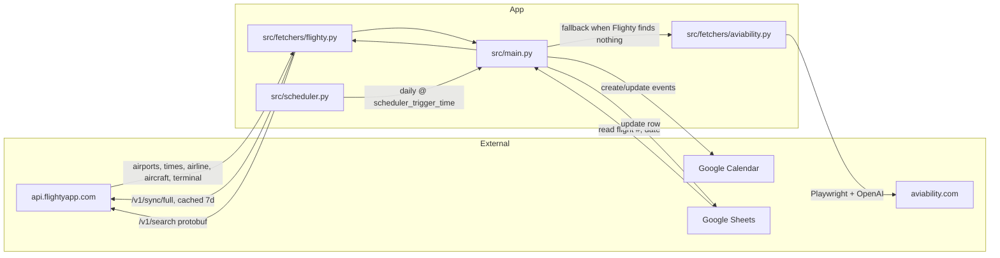

# Flight Calendar Updater

[](https://github.com/momonala/flight-calendar-updater/actions/workflows/ci.yml)

Syncs flight details from a Google Sheet to Google Calendar. Looks up schedules on Flighty's private protobuf API (reverse-engineered from the iOS app). When Flighty finds nothing or fails, it falls back to scraping aviability.com with Playwright and extracting the fields with OpenAI. Each source lives in `src/fetchers/` and exposes the same `get_flight_info(date, flight_number)` function; the order is set by `FETCHERS` in `src/fetchers/__init__.py`.

## Prerequisites

- Python 3.12+
- uv (Python package manager)
- Google Cloud project with:
  - Sheets API enabled
  - Calendar API enabled
  - Service account with JSON key file

## Installation

1. Clone and install:
   ```bash
   git clone https://github.com/momonala/flight-calendar-updater.git
   cd flight-calendar-updater
   curl -LsSf https://astral.sh/uv/install.sh | sh
   uv sync
   uv run playwright install chromium   # browser for the aviability.com fallback
   ```

2. Set up Google credentials:
   - Create service account in [Google Cloud Console](https://console.cloud.google.com/)
   - Enable Google Sheets API and Google Calendar API
   - Download JSON key → save as `google_application_credentials.json`
   - Share your Google Sheet with the service account email
   - Share your Google Calendar with the service account email

3. Configure secrets via `.env` (copy from `.env.example`):
   ```bash
   cp .env.example .env
   ```
   ```env
   SPREADSHEET_ID=your-google-sheet-id   # from the sheet URL
   CALENDAR_ID=your-calendar@gmail.com   # email or calendar ID
   FLIGHTY_AUTH_TOKEN=eyJ...             # see below
   FLIGHTY_BUILD_TOKEN=eyJ...
   OPENAI_API_KEY=sk-...                 # only for the scraper/AI fetchers
   ```

4. Get the Flighty tokens. Capture the app's traffic (e.g. mitmproxy on the phone) and copy two
   request headers: `authorization: Bearer ...` is `FLIGHTY_AUTH_TOKEN` (anonymous account, does
   not expire); `x-flighty-build-token` is `FLIGHTY_BUILD_TOKEN` (baked into the app build).
   Flighty's search endpoint has a daily quota; once it returns 429 the limit resets the next day.

## Running

```bash
# One-time run: only look up future rows that have just a date and flight number
uv run main

# Re-fetch every future flight (refreshes schedule changes; uses more of the Flighty quota)
uv run main --update

# Clear the cached Flighty airline table (otherwise kept for 7 days)
uv run main --clear-cache

# As daemon (runs daily at scheduler_trigger_time in pyproject.toml, default 10:00)
uv run python -m src.scheduler
```

## Project Structure

```
flight-calendar-updater/
├── src/
│   ├── main.py                   # Entry point: orchestrates sheet read → flight lookup → calendar update
│   ├── fetchers/
│   │   ├── __init__.py           # get_flight_info: tries each source in FETCHERS order
│   │   ├── flighty.py            # Primary: Flighty private API (protobuf wire codec, airline table, search)
│   │   └── aviability.py         # Fallback: Playwright scrape of aviability.com + OpenAI field extraction
│   ├── datamodels.py             # Pydantic models: FlightInfo, GSheetRow
│   ├── calendar_client.py        # Google Calendar create/update logic
│   ├── sheets_client.py          # Google Sheets read/write logic
│   ├── scheduler.py              # Daily cron wrapper using schedule library
│   ├── config.py                 # Non-secret config (pyproject.toml) + Google credentials
│   └── env.py                    # Secrets loaded from .env
├── tests/
│   ├── conftest.py               # Shared fixtures
│   ├── test_datamodels.py        # FlightInfo and GSheetRow validation tests
│   ├── test_fetchers.py          # Fallback order across sources
│   ├── test_fetcher_flighty.py   # Flighty codec, cache and parsing tests
│   ├── test_fetcher_aviability.py  # Scraper and LLM extraction tests
│   └── test_main.py              # Pipeline orchestration tests
├── .env                          # Secrets: OpenAI, Sheet + Calendar IDs, Flighty tokens (not committed)
├── .env.example                  # Template for required env vars
├── google_application_credentials.json  # Service account key (not committed)
├── pyproject.toml                # Dependencies and non-secret config
└── install/
    ├── install.sh                # Linux systemd setup script
    └── projects_flight-calendar-updater.service  # systemd unit file
```

## Architecture



## Key Concepts

| Concept | Description |
|---------|-------------|
| `FlightInfo` | Pydantic model holding parsed flight data (times, airports, terminals, aircraft) |
| `gcal_event_id` | Sheet column storing Calendar event ID for update vs. create logic |
| Timezone handling | Flighty returns epoch seconds plus each airport's IANA zone; times are built with `zoneinfo` |
| Protobuf codec | Schema-less decoder in `fetchers/flighty.py`; fields are addressed by number, no `.proto` files |
| Airline cache | Flighty's airline table cached to `.cache/flighty_airlines.json` for 7 days; cleared with `--clear-cache` |
| Date formulas | Sheet columns `Date` and `Weekday` use Excel formulas, not raw values |

## Google Sheet Schema

| Column | Type | Description |
|--------|------|-------------|
| `Year`, `Month`, `Day` | int | Date components for formula |
| `Date` | formula | `=DATE(A, MONTH(B&1), C)` |
| `Weekday` | formula | `=TEXT(Date, "DDD")` |
| `Flight #` | string | e.g., `BA 999`, `LH2206` |
| `gcal_event_id` | string | Populated by script after event creation |
| `Departure Airport`, `Arrival Airport` | string | IATA codes, populated by script |
| `Departure Time`, `Arrival Time` | string | With timezone offset, e.g., `14:30 (CET +1)` |
| `Duration` | string | `HH:MM` format |
| `Origin`, `Destination` | string | City names |
| `airline`, `aircraft` | string | From Flighty |
| `departure_terminal`, `arrival_terminal` | string | From Flighty |
| `departure_country`, `arrival_country` | string | Country names |

## External Dependencies

| Service | Usage | Notes |
|---------|-------|-------|
| Flighty private API | Flight schedule lookup | Unofficial; needs two tokens from a traffic capture; daily search quota |
| aviability.com + OpenAI | Alternative scraper fetcher | Not used by `main`; needs Playwright Chromium and `OPENAI_API_KEY` |
| Google Sheets API | Read/write flight tracker | Requires service account |
| Google Calendar API | Create/update events | Requires service account |
